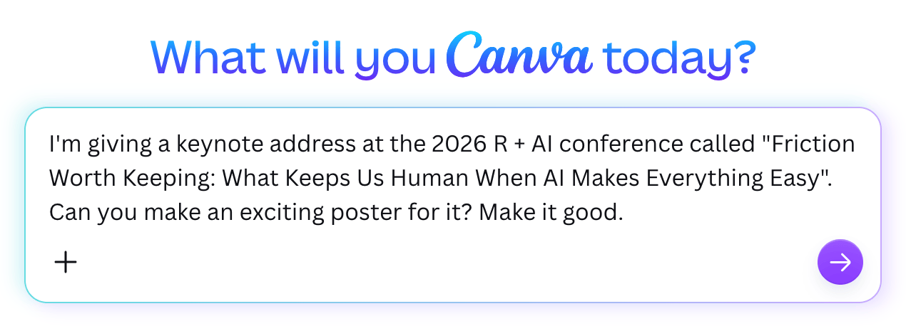
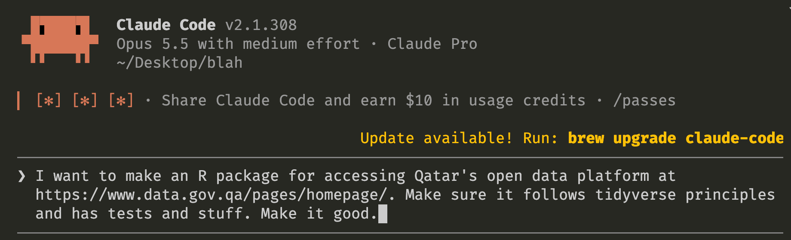
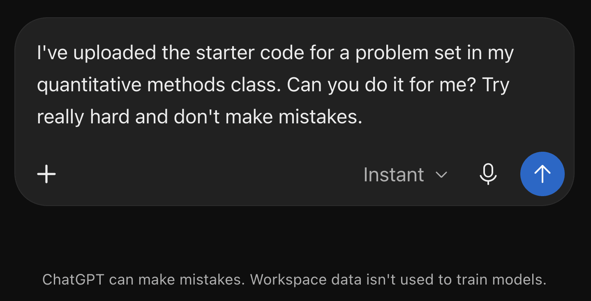
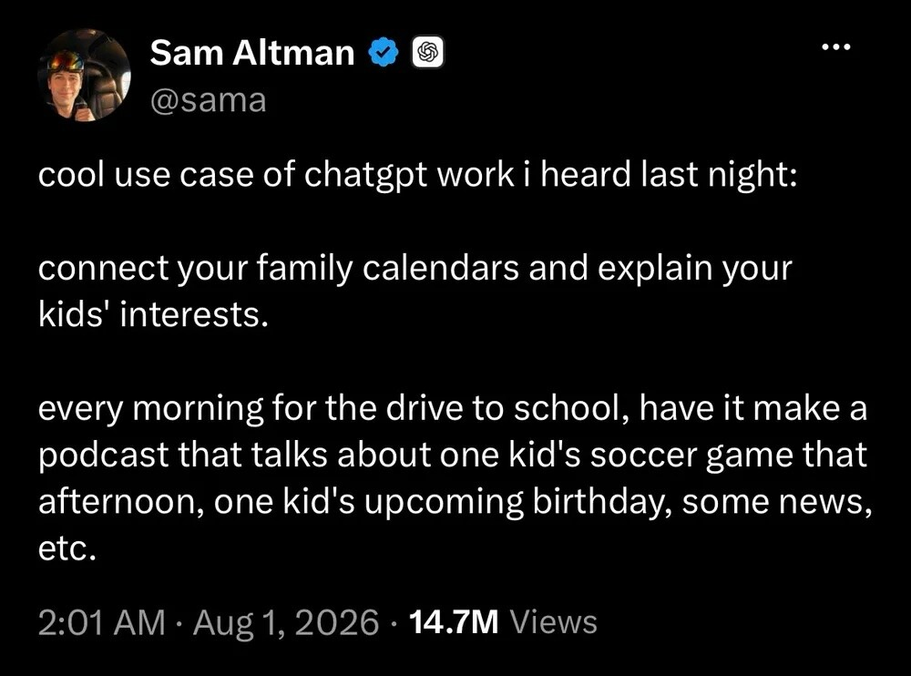
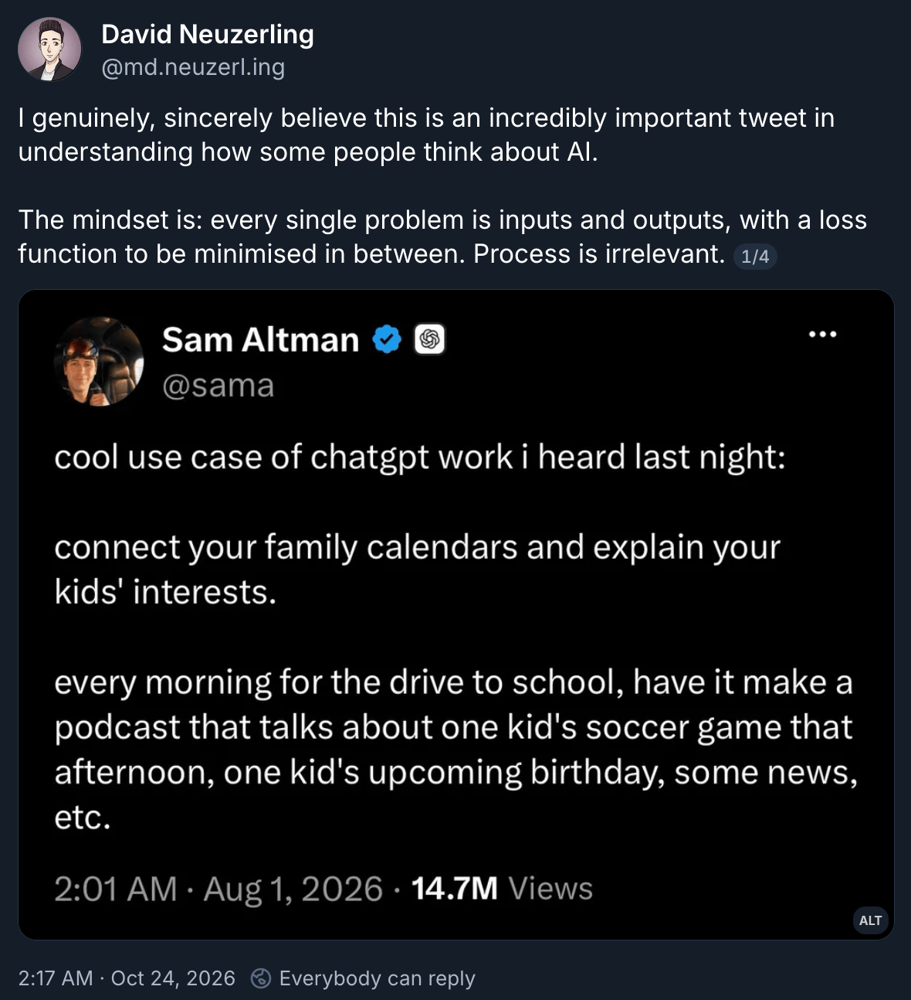
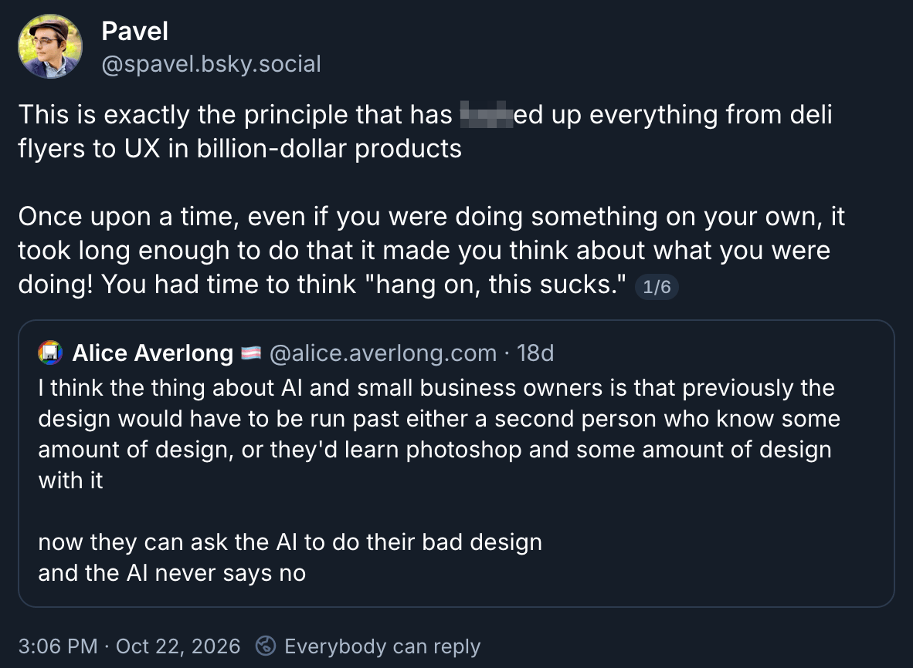
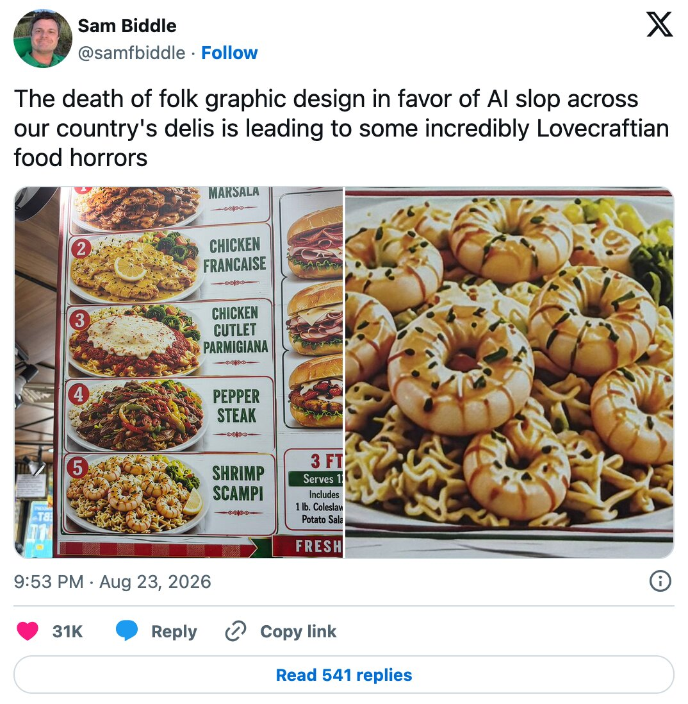
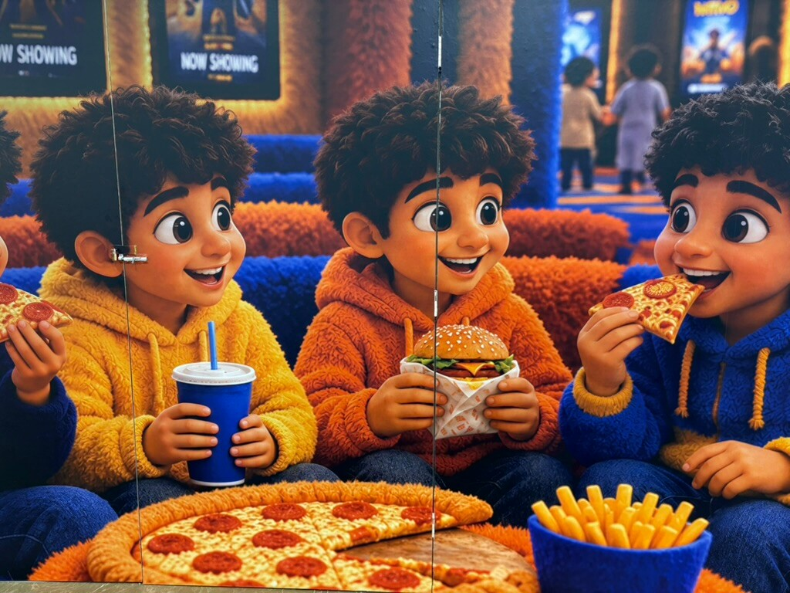
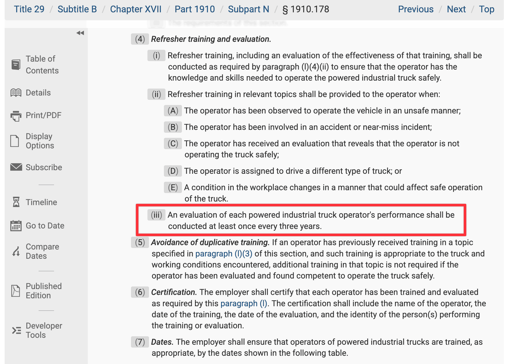

::: {.callout-note title="R + AI 2026"}
I gave this keynote talk at the R Consortium's [2026 R + AI online conference](https://rconsortium.github.io/RplusAI_website/Abstracts.html#andrew-heiss) on November 10, 2026.

I'll post a video here once they post it to YouTube.
:::

::: {.callout-note title="Slides" collapse="true"}

<p style="line-height: 2.5"><a class="btn btn-success me-2" target="_blank" href="slides.html"> &ensp;Open slides in new window</a></p>

```{=html}
<div class="ratio ratio-16x9">
<iframe class="slide-deck" src="slides.html" style="padding: 0 0 0.5em;"></iframe>
</div>
```
:::

::: {.content-visible when-format="html"}
## Introduction {.hide}
:::

A few months ago, I was reviewing a quantitative political science paper. It had minor issues with the theoretical framing, and the analysis was a little bit off, so I made some suggestions in my review. I even simulated some data that looked like theirs so I could illustrate some possible plots they could make to better communicate their results, and I created an anonymous Posit Connect Cloud account so I could make a URL to a Quarto HTML page to include in my review. (I think I might sometimes go a little overboard with my reviews 😬.) I submitted the review to the editors with a recommendation of minor revisions, and moved on with my day.

Months later, I was asked to review a revised version of the paper. I downloaded it and started reading it, but couldn't remember ever having read it. This was a little understandable—I spent this year moving my family across the world from Atlanta, Georgia to Doha, Qatar in the middle of a war, so peer reviews have been one of the last things on my mind. I dug up my earlier review and was wildly confused. Nothing in my review really matched any of the content in this new revision. The revised version had been 100% rewritten, with all of the hypotheses completely reversed, completely new data, completely new methods, and completely new results.

As I read it, the paper oozed with Claude-flavored English. It restated its theory and hypotheses every few pages, and the argument constantly evolved as the context window filled up and the model lost track of what it had already written.

On the surface, it looked well written and comprehensive. There was not a single typo. It seemed perfect. But I had a miserable time reading and evaluating it. Beyond the incoherent methodological issues and complete reversal of the argument, my trust had been broken. I wasn't reviewing anything a human made—I was reviewing a hollow simulacrum of an academic paper. Writing the review was really hard—I tried to give some suggestions, but knew that whatever I said would get ignored and thrown into an LLM prompt for the next revision. I submitted a paltry review (but still nice! I think I still recommended a revise and resubmit), and told the editors that it seemed like nobody was behind this.

From what I gather from LinkedIn and Bluesky, this is hardly a new phenomenon. Academic journals and conferences and preprint servers are getting swamped with article-shaped submissions. Just a couple days ago, the American Journal of Political Science—one of the flagship journals in my field—[instituted a 3-submission-per-year limit](https://ajps.org/2026/11/04/new-ajps-submission-cap-policy/) to help deal with the wave of AI-enabled papers.

Generating apparently perfect content nowadays is trivial thanks to LLMs.

Need a poster for an event?



An R package to access an API?



An answer for a problem set?



It's all just a prompt away. The friction is just… gone.

This isn't necessarily bad! Things like coding and graphic design have arguably been "democratized" and the barriers to entry have been substantially lowered. For people who are already experts, LLMs have turbocharged projects. 

At posit::conf a few months ago, many speakers talked about how they've stopped handwriting code. I'm a huge fan of Quarto and have been following the development of [Quarto 2](https://github.com/quarto-dev/q2), which is lightning fast and exciting, and where and Claude Code plays a central role in development. I've been using Claude Code myself to automate trivial tedious tasks like updating dates in YAML metadata for my course websites, debugging weird CSS quirks, and converting R Markdown-based {xaringan} slides to Quarto-based revealjs slides. 

Over the next couple days, this very conference will be full of talks about new and neat uses of LLMs and AI in R development and statistical analysis. All this reduction in friction is great and exciting.

But today I want to argue that *some* friction is worth keeping and, more importantly, that this friction is a big part of what keeps us human.

## Friction and formation

First, though, a caveat. Before you all think that I'm 100% anti-AI and 100% pro-friction—that because *I* walked to school in the snow uphill both ways and spent years braving the mean forums of StackOverflow, everyone should suffer too—let me clarify that I think we *should* get rid of lots of friction! I want to distinguish between two types of friction: incidental and formative.

Incidental friction is tedious friction that gets in our way. In R, this involves things like wrangling column names, remembering how many backslashes to use when escaping regular expressions, fixing LaTeX errors, writing roxygen boilerplate, building and running tests, and so on. In design this involves applying different paragraph styles to text, modifying colors throughout a complex document, and setting up asset exports with a bunch of different sizes and formats. In research this involves tracking down and sorting PDFs, standardizing metadata in a reference manager, and summarizing abstracts and key findings. LLMs are great at removing the busywork of incidental friction, and good riddance!

Formative friction is different. I currently teach at Georgetown University in Qatar. Georgetown is a Jesuit university and is grounded on a set of ten core values. 


One of these principles is *cura personalis*, or "care of the whole person." In the realm of education, this entails "the intentional cultivation of mind, body, and spirit in the educational development or *formation* of each student" [@AdamNebelOlsen2026, 44]. My goal as a Georgetown educator is to focus on *formation*, tailoring my pedagogy and my work to the individual needs of students. This is an immensely human-centered approach.

The process of formation requires growth and development and adaptation, all of which involves friction. The struggle inherent in formative friction is what creates beautiful things and what makes us who we are.

My favorite way of thinking about formative friction is this idea of [The Design Squiggle](https://thedesignsquiggle.com/), which demonstrates the journey of going from an idea to a completed, well-designed, refined output. 


You start with mess and uncertainty on the left, go through a process of research, prototypes, iteration, generation, thinking, and struggle, until ideas begin to crystallize into something neat and beautiful in the end. This squiggle was originally created to describe graphic design, but it applies far more broadly. When I create a new R package, my internal API is a jumbled mess of approaches until it eventually stabilizes into something consistent and useful. Students begin university not knowing what they'll do with their lives, but eventually come out as different people with—ideally—loftier goals.

That messy middle area is where formation occurs. Revisions, feedback, dead ends, experiments, readjustments, and so on help develop our skills, our expertise, our taste, our judgment, and our trust in our communities.

LLMs take the design squiggle and transform it to this:


We get to cut out the middle section and skip from idea to finished product. 

This is how LLMs are explicitly marketed! Adobe Creative Cloud now has a prominent chat prompt window in Photoshop, Illustrator, and InDesign so you can jumpstart the creation process. ChatGPT and Claude can generate images and video in whatever style you want. Searching for things on Google used to involve clicking on links and exploring the results—now it all just comes pre-summarized. AI boosters have been promoting all sorts of time-saving lifehacks as possible uses for their products.

In August, Sam Altman tweeted about creating an automated family podcast with updates and customized reporting for the kids' activities. There were lots of takes and jokes and criticisms about it, mostly mocking the idea of automating away family time. 



But [this commentary from David Neuzerling](https://bsky.app/profile/md.neuzerl.ing/post/3mylcs6qr6s2u) stood out to me the most, describing a worldview where friction is the enemy:



> Every single problem is inputs and outputs, with a loss function to be minimised in between. **Process is irrelevant**.

Need words for an article? Generate them. Need code for an analysis? Generate it. Need an image? Generate it. Do it all in whatever way is fastest and most frictionless.

I, however, believe that process matters. To illustrate the value of formative friction, I want to look at its role in four central areas of the human experience: learning, creating, knowing, and trusting.

### Learning

Since ChatGPT was released in 2022, some of the loudest anti-AI voices have come from educators, because LLMs have had an enormous impact on student behavior and learning outcomes.

We've all seen this, or done this ourselves: students cram the night before the final, do well on the exam, and two weeks later can't remember anything. Cognitive scientists have studied why this happens, finding that learning builds two different kinds of strength: (1) retrieval strength, or how easily a concept or skill comes to mind right now, and (2) storage strength, or how durably knowledge is encoded for later use [@BjorkBjork2011]. Cramming for a test enhances retrieval strength, but does very little for storage strength. Students who cram can perform well, but they likely don't really learn.

The annoying thing about learning is that the tasks and approaches that build storage strength are uncomfortable and not fun. Working through tricky problem sets, writing essays to wrestle with concepts, getting and incorporating feedback, and synthesizing knowledge from other classes are all things designed to slow you down and mess you up. Robert and Elizabeth Bjork call these "desirable difficulties" [@BjorkBjork2011] and find that "the conditions that produce the most errors during acquisition are often the very conditions that produce the most learning” [@SoderstromBjork2015, 176].

In other words, learning is a process of formative friction. Our wrong turns, dead ends, and struggles *are* learning. Desirable difficulties are this tangle of lines in the squiggle:


LLMs, however, are phenomenal answer machines. Paste an entire problem set into an LLM and you can get perfectly polished answers. Circumventing formative friction lets students get correct output, but I actually don't care about the correct output. I've graded hundreds of problem sets where where students estimate the difference in average weight between male and female penguins. I don't ask students to do this because I need to know how much penguins weigh—I do it so they can learn the process of finding the answer. The actual output isn't the point.

### Creating

The design squiggle was originally invented to describe the process of creation, and formative friction remains central to this. Creating things slowly gives us time to reflect and develop notions of taste. Books, poems, art, posters, images, illustrations go through all sorts of iteration and rounds of edits and changes and adjustments, giving creators time to think about what they're making. 

In a world of instant output, though, that time for introspection and thinking is gone. I really like what UX designer Pavel Samsonov [recently noted about this phenomenon](https://bsky.app/profile/spavel.bsky.social/post/3myhmrxs6ek2u):



> Once upon a time, even if you were doing something on your own, it took long enough to do that it made you think about what you were doing! You had time to think "hang on, this sucks."

Nobody steps in to push back or say no—not even ourselves.

By now we've likely all seen weird AI-designed things out in the world. There's been a growing trend of AI slop menus:

::: {.column-body-outset layout-ncol=2 layout-valign="center"}



:::

One of the malls near my apartment in Doha has gone all in with AI-based art, with huge unsettling murals of fuzzy people sitting on fuzzy couches holding fuzzy balloons wearing fuzzy clothes eating fuzzy mis-oriented burgers and fuzzy pizza and drinking fuzzy soda, all with identical faces.

::: {.column-page-inset layout="[[2.25,4,4]]"}



:::

Doha has a striking skyline, and one of its most iconic buildings is this portal-like Katara Towers. 


An internationally known pizza chain here recently created an ad campaign to promote its new pan pizza, specifically tailored to Qatar. [An AI-generated video](https://www.youtube.com/watch?v=Tboq1ML8dZk) shows a cast of cheese-shaped superheroes flying around different Doha landmarks. 

::: {.column-page-inset layout-ncol=2}


:::

Beyond the uncanny valleyness of these characters, the most striking thing for me is what happens in the background. The Doha skyline morphs to something else in each shot in the video. The iconic Katara Towers are deformed differently in four different scenes:

::: {.column-body-outset layout="[[1.66,1.51],[1.31,0.67]]"}


:::

To me this is utterly baffling—it'd be like if the Statue of Liberty or the Empire State Building were turned sideways or partially melted in a video about New York City. This video feels hollow to me. The design inconsistencies arise from an absence of friction and an absence of humanity—nobody was looking and saying "wait, no, this sucks, let's fix that."

In my data visualization classes, I spend a couple weeks teaching core graphic design principles. In one assignment, I provide students with a poorly designed poster and ask them to (1) reverse engineer the designer's thought process, (2) analyze what they were originally trying to communicate with their design choices, and (3) redesign a new poster that meets the audience's needs while following good design principles. 

In the pre-AI world, we could think about the process behind created objects. What was the author thinking when they chose these words? Why did the artist choose these colors? Why did the designer choose that font and that color scheme? There's expertise lurking beneath these things, and we can analyze that thought process. Pre-2022, students really liked this redesign assignment since it helped them develop appreciation for the friction of the design process and showed them how much thought can go into little details.

The last time I taught the class, 80% of the redesigns were done with a single prompt in Canva. They look okay-ish, but when you examine them closely, they're weird and hollow. Elements are misplaced and misaligned. Colors are inconsistent. Kerning is off. Wording is stilted. Analyzing them is hard too, since there's no human thought to try to reverse engineer.

### Knowing

The process of knowledge creation also requires formative friction. Recently, the best illustration of this has been in mathematics. Mathematicians have a whole library of difficult, unresolved problems and conjectures that have yet to be formally proved. Some are really abstract like the [Riemann hypothesis](https://en.wikipedia.org/wiki/Riemann_hypothesis): Do all non-trivial zeros of the Riemann zeta function have a real part equal to one half? (What the heck is the Riemann zeta function??) Some are more understandable, like the now-proved [four color theorem](https://en.wikipedia.org/wiki/Four_color_theorem): Can you make a map with no more than four colors so that no two adjacent regions have the same color?

Though many of these problems are unresolved, they provide a playground of sorts for mathematicians to work in. According to a recent ["Math and AI" declaration](https://mathandai.org/) issued by 28 Fields Medal recipients,

> Famous problems have often served as landmarks and lighthouses against which one can measure an improved understanding of this landscape. Solving one of these problems has been a certain sign of new insights and interesting methods, which would then be studied by a community of mathematicians, through a long and arduous process of talks, discussions, simplifications [@AvilaBhargavaBirkar2026].

Working to solve these problems creates useful byproducts—newer methods, newer approaches to proofs, and importantly, a community.

In what some have called the "mathpocalypse," in October, [OpenAI released 722 manuscripts](https://en.wikipedia.org/wiki/OpenAI_bulk_release_of_mathematical_papers) that claim to have solved hundreds of open mathematical issues. At a technical level, I find this fascinating—these frontier models have seen enough data across so many different fields that they can piece together oblique strategies to solve outstanding problems. 

But also, for me, this feels incredibly hollow. 

OpenAI basically said "hey here are all the solutions to everything you've ever wondered about kthxbai." The process of generating knowledge was completely short-circuited. OpenAI researchers [didn't check all the output themselves](https://www.scientificamerican.com/article/the-most-exciting-claims-from-openais-heap-of-new-proofs/) and [many of these papers have already been heavily revised or retracted](https://retractionwatch.com/2026/10/08/openai-withdraws-preprints-722-manuscripts-unsolved-math-problems/). It'll take [months for mathematicians to work through the output](https://web.archive.org/web/20261008105948/https://www.newscientist.com/article/2592703-the-most-interesting-mathematical-discoveries-in-openais-722-new-papers/) to see what LLMs actually ended up doing and if they're actually valid or useful.

I'm not a mathematician so I'm not directly worried about this mathpocalypse, but I am incredibly worried about the absence of friction here. In social science, we also create useful byproducts and theories and communities as we work to create knowledge. Science is a human endeavor, and formative friction is a central part of this. 

The "Math and AI" declaration concludes with a warning that goes well beyond math:

> **We are witnessing a general threat to intellectual work, with misalignment between the outcome of the use of AI and its initial purpose.** **In many fields and activities, years of training have traditionally served not only to produce a final answer or product, but also to develop understanding and the ability to formulate new questions and ideas.** However, building on a vast body of previous human work, AI systems are becoming increasingly capable of producing the results of such work directly, and these goals cease to align. The issues the mathematical community faces now are similar to issues that other scientific and creative professions are facing, and **indicate issues that all of humanity might face: how to make sure that, as AI changes the way work is done, we do not lose sight of what that work was meant to achieve in the first place** [@AvilaBhargavaBirkar2026].

### Trusting

Finally, formative friction and living in the mess of the design squiggle allows us to build community and cultivate trust.

For example, [Hadley Wickham recently shared his thoughts](https://substack.hadley.nz/p/what-is-slop) on what constitutes AI "slop." He shows an AI-made video introducing one of his joke R packages: [{genzplyr}](https://hadley.github.io/genzplyr/), which translates core {dplyr} functions into Gen Z slang, where `filter()` becomes `yeet()`, `group_by()` becomes `squad_up()`, and so on. 

{fig-align="center" width="40%"}

It's a silly video explaining a silly package, but it's—as Hadley admits—100% slop. There is explicitly no human thought in the video. Hadley says "I invested maybe 5 minutes of my time and zero taste, opinions, or thoughts. While the output might look polished, it represents zero human effort, making it slop."

This aligns with what I talked about earlier with the need for friction in creation—this {genzplyr} video is similar to the pizza advertisement, where nobody stepped in to say "hey wait, let's adjust some stuff." But what I find most interesting about Hadley's reflection on his goofy video is how he connects it to the idea of trust:

> **I think this is one of the most dangerous features of AI: it trashes our existing heuristics for effort and trust**. It used to be that making a slick video or writing a 40-page document implied that you cared enough to at least put in the effort, but now **those signals are gone**. It’s becoming increasingly difficult to tell what work represents genuine human effort and caring, and what work is the result of a few minutes of prompting and a few dollars of token spend.

Polished creative output used to be a sign of serious thought, but now it's not. For me, seeing overly polished things is now a signal that perhaps nobody actually was involved. I *love* seeing typos and idiosyncratic writing in student work nowadays. Those little imperfections help point to the human behind the output and make me trust the work just a little more.

Of course, AI companies know this and can purposely add little human-shaped imperfections to help simulate trust. For instance, in July as we were preparing to move to Qatar, I had to get rid of a bunch of ancient technology. Via Google, I found the phone number for a specialized electronic recycling company that provided drop-off services. I called them to confirm their hours and talked to a "person" who sounded 80% natural and human. I heard indistinct office chatter in the background, but occasionally could hear snippets of actual words, like people making lunch plans. I had suspicions that it might all be an elaborate AI, but the lunch plan background noise convinced me that it was probably all real. 

I loaded up my stuff in the car and drove an hour across Atlanta, only to discover that the office was closed. I contacted a real person at the company later to see what had happened and they told me something along the lines of "yeah, that's our AI customer service system; sometimes it just makes up stuff like that."

I was so frustrated and my trust in the organization cratered. The absence of a human and the frictionless lack of basic social interactions cost me hours of lost time and the company waved it off like "oh yeah, that happens."

Formative friction is necessary for building trust. Lots of our software communities have been grappling with this over the past few years. I volunteer with rOpenSci, which peer reviews R software packages. Many packages today use AI to some extent, and there's been a substantial increase in heavily—or even wholly—AI-generated packages. A few package reviews have involved GitHub issues with Claude and GitHub Copilot, dressed up to seem like humans, which has been really demoralizing for reviewers and editors. In February, [rOpenSci described how it has been thinking](https://ropensci.org/blog/2026/02/26/ropensci-ai-policy/) about the role of peer review in the age of AI, ultimately concluding that humans are still central, stating that "we do not want software review to become a service in which our human volunteers validate largely AI-generated software." Packages now need to show evidence of human authorship, and fully automated work, like issues and pull requests written only by bots, is strongly discouraged.

Other software and research organizations have made similar policies. [openRxiv, for instance, has stated](https://openrxiv.org/approach-to-ai/) that humans must be accountable, human judgment is required, and that humans make the final decision. [Rust Forge's community guidelines](https://forge.rust-lang.org/policies/llm-usage.html) ban LLM-authored comments in issues and pull requests and prohibit LLM-only code review. Humans must be involved throughout. This means that both software development and reviews can take longer, since humans must be directly involved, but this friction creates, cultivates, and maintains community trust.

## Friction and forklifts

So, incidental friction is annoying and tedious and can be automated away with LLMs. AI is really good at removing this kind of friction, and we can make some incredible stuff with the output it generates and with the time we save.

Formative friction, on the other hand, is still a central part of the human experience. It's necessary to learn, to create, to know, and to trust. However, AI is really good at removing that kind of friction too. We can go from idea to finished output with just a prompt. But, I would argue, we lose something when skipping over the messiness of human thinking.

I'm an educator with an explicit institutional mandate to help students engage in formation—I naturally see almost everything as a good opportunity for formative friction. But out in the real world, that's not the case. We have to create ever more code and output and text. The software development world now largely runs on AI—so much of modern development today involves orchestrating and babysitting LLM agents. Most of you here are not students—you're regular working professionals now and are no longer expected to be in "formation mode" all the time.

So how do we know which kinds of friction to keep and when? There's no single right answer. I'd like to offer my own personal framework for thinking about when to turn to LLMs and when to rely wholly on my own thinking [@Heiss2026].

In *The New Yorker* in 2024, author Ted Chiang made a now-popular analogy [@Chiang2024]:

> Using ChatGPT to complete assignments is like bringing a forklift into the weight room; you will never improve your cognitive fitness that way.

In my networks of university professors, at least, this imagery has spread like wildfire and you hear it at nearly every discussion about AI and teaching. And I agree with him—using LLMs to skip formative friction gets us results, but we're not reshaped and improved by the process. 

However, I don't think we should stop Chiang's analogy here. Outside of weight rooms, forklifts have enormous value. The contents of shipping containers can be emptied and redistributed quickly and efficiently, allowing for faster global transport and more stuff in general. Look at this warehouse here—there's no way to get those pallets down by hand!


Forklifts are great for both everyday routine tasks and for heavy, complicated tasks. Nobody tells warehouse workers to get off the forklift and lift pallets by hand to become better people. Forklifts are incredibly helpful in the real world, but only after the mastery and practice that comes from formative friction.

Additionally, in the United States, forklift operators must renew their certification and be re-evaluated every three years to avoid skill atrophy and to ensure that current best practices are followed ([29 CFR §1910.178](https://www.ecfr.gov/current/title-29/subtitle-B/chapter-XVII/part-1910/subpart-N/section-1910.178)).



I've stretched this forklift analogy a lot, but I still find it enormously useful. As goofy as this sounds, I've come to think about tasks in relation to forklifts. When I need to create or do something, I've gotten into the habit of asking myself a series of questions that determine how I'll use AI:

- Is the friction of the task related to learning and improving? Are the side effects of the friction useful and important? Is the output directly human-facing? 

  If so, I'm in a gym situation and shouldn't circumvent the formative friction.

- Is the friction of the task routine, repetitive, boring, and related to something I'm already good at? Does the task involve something really complex, but something I could theoretically do myself if needed?

  If so, I'm in a standard, routine warehouse situation and should use LLMs to avoid the incidental friction.

- Does the task involve something that I used to be good at but haven't revisited for a while? Could the friction end up being useful? Do I have time to slow down and relearn stuff? 

  If so, I'm in a recertification situation and should minimize LLM use and embrace the opportunity for some formative friction.

## Friction worth keeping

Remember that paper I reviewed where the authors rewrote the entire thing with Claude. I'm fine with the fact that the authors used an LLM—I use LLMs! The issue was that they skipped the squiggle and went straight for perfectly polished output without worrying about the process.

But the output isn't really the point. Yes, the paper is what ultimately gets published and read, but it represents a lot of thought and deliberation and theorizing and rewriting and grappling and arguing and revising. Process matters. AI is really good at zooming us through that process and removing all friction: it can clean up, test, and refactor your code (yay) and it can write responses to reviewers (ehh). LLMs can't tell the difference between the two types of friction. We have to do that.

So yeah, use LLM forklifts! They're great! Get rid of the incidental friction. Take advantage of how well LLMs can synthesize stuff from across their huge training data. These things are powerful and neat. 

But sometimes we need to slow down and sit in the squiggle. Don't take LLM forklifts to the gym. Take the time to "recertify" skills you've let atrophy. Allow time to discover the thing you're making actually kinda sucks and try again. *That's* the friction worth keeping, and *that's* what keeps us human.
