# {background-gradient="linear-gradient(30deg, , )"}

## {.center}

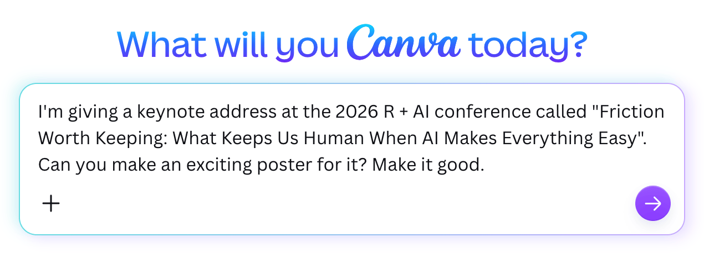{.shadow fig-align="center"}

## {.center}

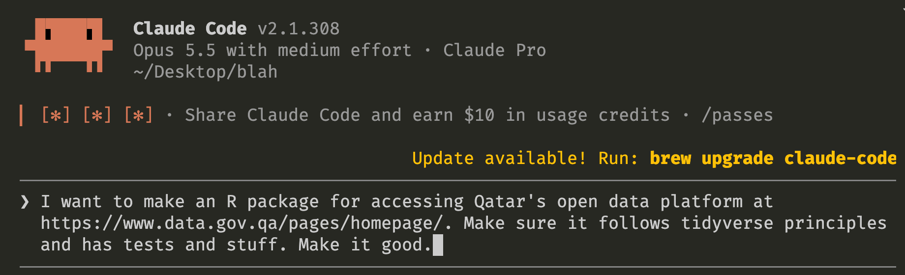{.shadow fig-align="center"}

## {.center}

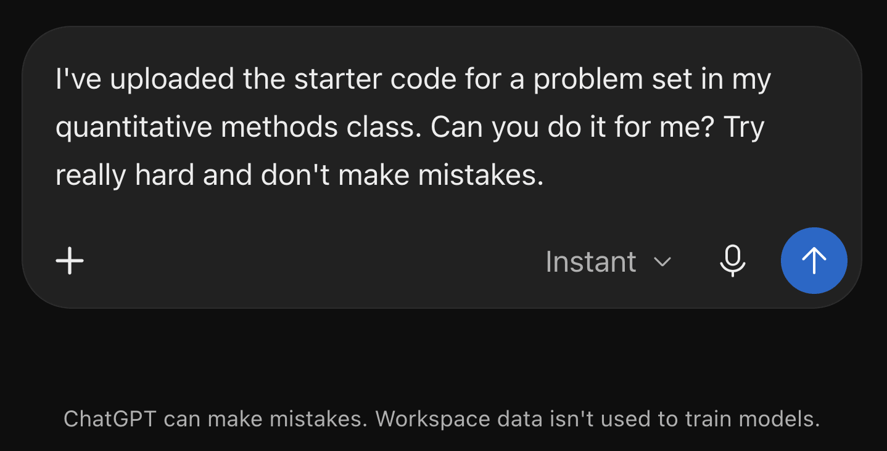{.shadow fig-align="center"}

## {.center .clr-3}

::: {.box-center .huge}
The friction is just… [*gone*!]{.text-clr-3}
:::

## {background-gradient="linear-gradient(30deg, , )"}

::: {.notes}
This isn't necessarily bad!… posit::conf… Quarto 2… Claude Code for trivial tedious tasks…

But today I want to argue that *some* friction is worth keeping.
:::

# Friction and formation {.section-slide background-gradient="linear-gradient(30deg, , )" background-image="img/background-hex-shapes.svg" background-opacity="0.25"}

## {background-gradient="linear-gradient(30deg, , )"}

::: {.notes}
A caveat: I'm not 100% anti-AI… two types of friction.
:::

## {.center .clr-2}

::::: {.columns .box-center .huge}
:::: {.column width="50%"}
::: {.fragment}
**Incidental**
:::
::::

:::: {.column width="50%"}
::: {.fragment}
**[Formative]{.text-clr-2}**
:::
::::
:::::

## {background-image="img/gu-values.jpeg" background-size="contain" background-color=""}

::: {.notes}
Georgetown is a Jesuit university and is grounded on a set of ten core values.
:::

## {.quote-slide .clr-2}

> *Cura personalis*: the intentional cultivation of mind, body, and spirit in the educational development or **formation** of each student

## {background-gradient="linear-gradient(30deg, , )"}

::: {.notes}
The process of formation requires growth and development and adaptation, all of which involves friction.
:::

## {.center}

{width="1400" fig-align="center"}

::: {.footer}
[The Design Squiggle](https://thedesignsquiggle.com/)
:::

::: {.notes}
The Design Squiggle. Mess and uncertainty on the left… the messy middle is where formation occurs.
:::

## {.center}

{width="1400" fig-align="center"}

::: {.notes}
LLMs take the design squiggle and transform it to this. This is how LLMs are explicitly marketed!
:::

## {background-gradient="linear-gradient(30deg, , )"}

::: {.notes}
Adobe, ChatGPT, Google summaries, lifehacks…
:::

##

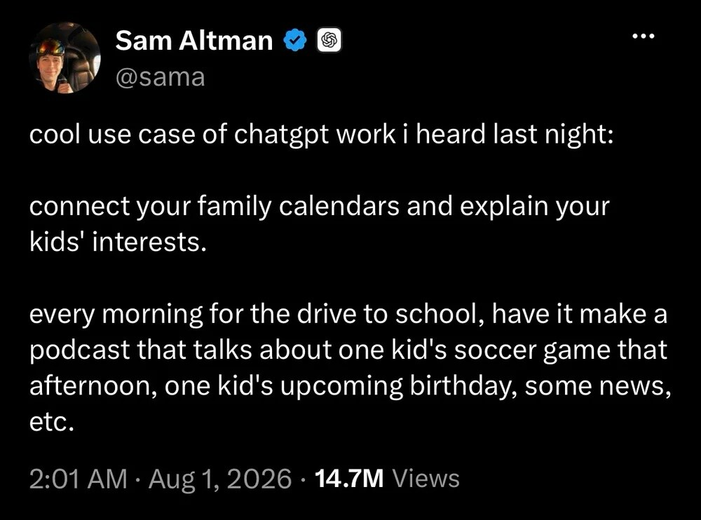{.r-stretch .shadow}

::: {.notes}
Sam Altman's automated family podcast.
:::

##

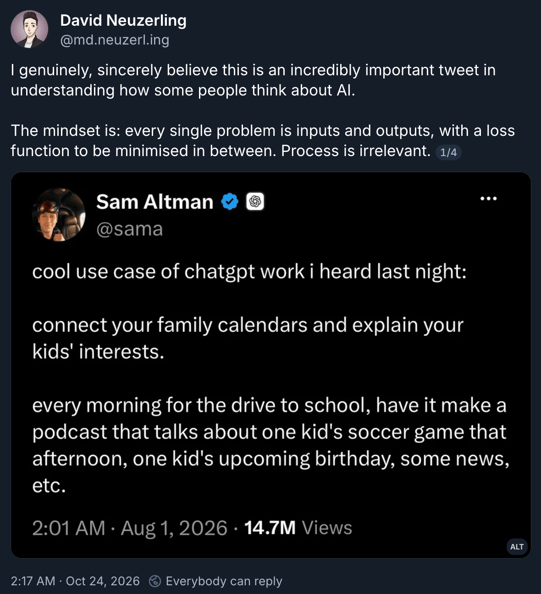{.r-stretch .shadow}

## {.center .clr-2}

::: {.box-center .large}
Learning • Creating • Knowing • Trusting
:::

## Learning {.section-slide background-gradient="linear-gradient(30deg, , )" background-image="img/background-hex-shapes.svg" background-opacity="0.25"}

## {background-gradient="linear-gradient(30deg, , )"}

::: {.notes}
Educators have been loudest… cramming… retrieval strength vs. storage strength (Bjork and Bjork 2011).
:::

## {.quote-slide .clr-2}

> The conditions that produce the most errors during acquisition are often the very conditions that produce **the most learning**

—Soderstrom and Bjork (2015, 176)

::: {.notes}
"Desirable difficulties"
:::

## {.center}

{width="1400" fig-align="center"}

::: {.notes}
Desirable difficulties are this tangle of lines in the squiggle.
:::

## {background-gradient="linear-gradient(30deg, , )"}

::: {.notes}
LLMs are phenomenal answer machines… penguins… the actual output isn't the point.
:::

## Creating {.section-slide background-gradient="linear-gradient(30deg, , )" background-image="img/background-hex-shapes.svg" background-opacity="0.25"}

## {background-gradient="linear-gradient(30deg, , )"}

::: {.notes}
Creating things slowly gives us time to reflect and develop taste.
:::

##

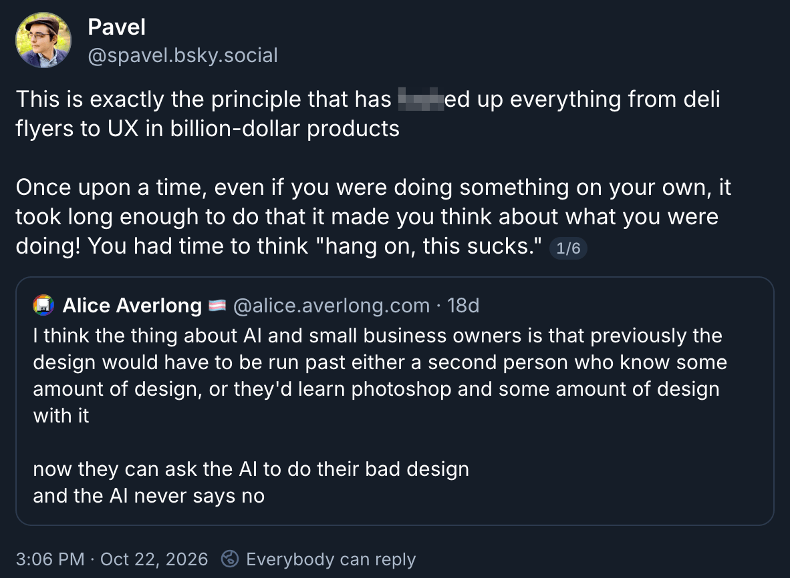{.r-stretch .shadow}

## {.quote-slide .medium .clr-2}

> You had time to think **"hang on, this sucks."**

—Pavel Samsonov

::: {.notes}
Nobody steps in to push back or say no—not even ourselves.
:::

##

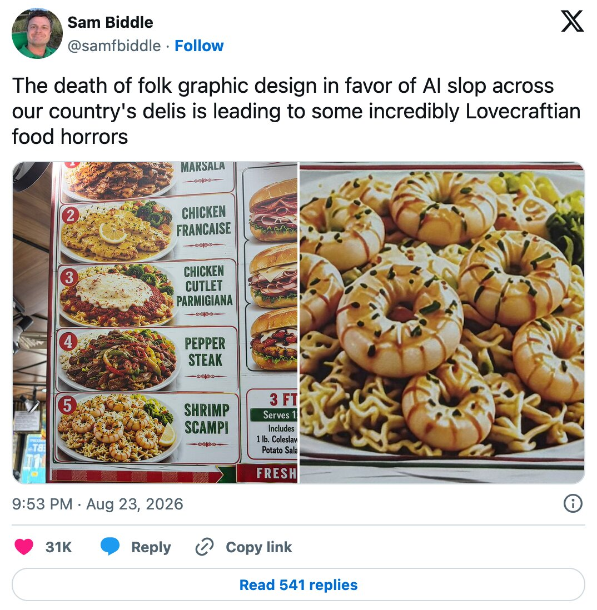{.r-stretch .shadow}

## {background-image="img/nbc-street-menu.jpeg" background-size="contain" background-color=""}

## {background-image="img/city-centre-3.jpeg" background-size="contain" background-color=""}

::: {.notes}
Mall in Doha: fuzzy people, fuzzy couches, fuzzy balloons…
:::

## {background-image="img/city-centre-2.jpeg" background-size="contain" background-color=""}

## {background-image="img/city-centre-1.jpeg" background-size="contain" background-color=""}

## {background-image="img/katara-towers.jpeg" background-size="contain" background-color=""}

::: {.notes}
Katara Towers
:::

## {background-image="img/pizza-character-1.jpg" background-size="contain" background-color=""}

::: {.notes}
Pizza chain ad: cheese-shaped superheroes flying around Doha.
:::

## {background-image="img/pizza-character-3.jpg" background-size="contain" background-color=""}

## {background-image="img/pizza-1.jpg" background-size="contain" background-color=""}

::: {.notes}
The Katara Towers are deformed differently in four different scenes.
:::

## {background-image="img/pizza-2.jpg" background-size="contain" background-color=""}

## {background-image="img/pizza-3.jpg" background-size="contain" background-color=""}

## {background-image="img/pizza-4.jpg" background-size="contain" background-color=""}

## {background-gradient="linear-gradient(30deg, , )"}

::: {.notes}
Statue of Liberty sideways… nobody saying "wait, no, this sucks."

Data viz poster redesign assignment… 80% done with a single Canva prompt.
:::

## Knowing {.section-slide background-gradient="linear-gradient(30deg, , )" background-image="img/background-hex-shapes.svg" background-opacity="0.25"}

## {background-gradient="linear-gradient(30deg, , )"}

::: {.notes}
Mathpocalypse: OpenAI released 722 manuscripts… hollow… kthxbai… revised or retracted.
:::

## {.quote-slide .small .dim .clr-2}

> **Famous problems have often served as landmarks and lighthouses against which one can measure an improved understanding of this landscape**. Solving one of these problems has been a certain sign of new insights and interesting methods, which would then be studied by a **community of mathematicians**, through a long and arduous process of talks, discussions, simplifications

—"A Severe Misalignment of AI in Mathematics"

::: {.footer}
["A Severe Misalignment of AI in Mathematics"](https://mathandai.org/)
:::

##

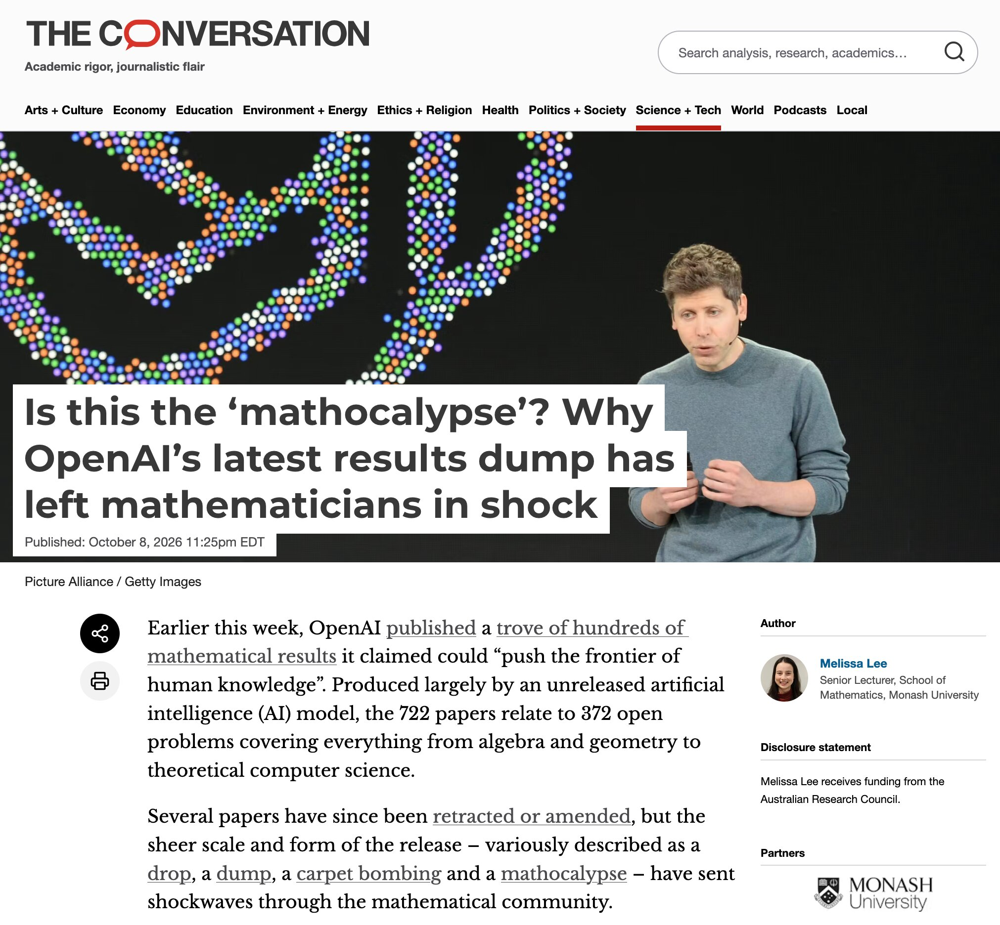{.r-stretch .shadow}

::: {.footer}
["Is this the ‘mathocalypse’? Why OpenAI’s latest results dump has left mathematicians in shock"](https://theconversation.com/is-this-the-mathocalypse-why-openais-latest-results-dump-has-left-mathematicians-in-shock-293837)
:::

## {.quote-slide .small .dim .clr-2}

> **We are witnessing a general threat to intellectual work, with misalignment between the outcome of the use of AI and its initial purpose.** In many fields and activities, **years of training have traditionally served not only to produce a final answer or product, but also to develop understanding** and the ability to formulate new questions and ideas. […] **[As] AI changes the way work is done, we [should not] not lose sight of what that work was meant to achieve in the first place**

—"A Severe Misalignment of AI in Mathematics"

::: {.footer}
["A Severe Misalignment of AI in Mathematics"](https://mathandai.org/)
:::

## Trusting {.section-slide background-gradient="linear-gradient(30deg, , )" background-image="img/background-hex-shapes.svg" background-opacity="0.25"}

##

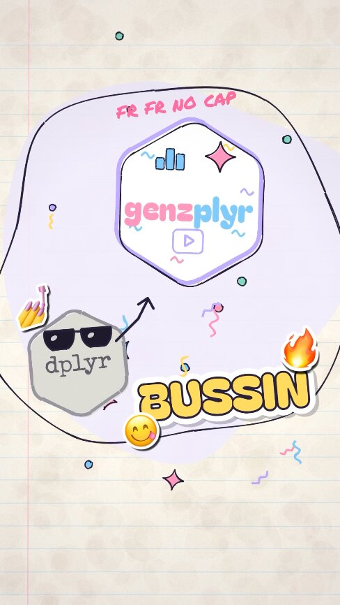{.r-stretch .shadow}

::: {.footer}
[What is slop?](https://substack.hadley.nz/p/what-is-slop)
:::

::: {.notes}
Hadley on slop; {genzplyr} video. "zero taste, opinions, or thoughts"
:::

## {.quote-slide .clr-2}

> I think this is one of the most dangerous features of AI: **it trashes our existing heuristics for effort and trust**. It used to be that making a slick video or writing a 40-page document **implied that you cared enough to at least put in the effort, but now those signals are gone**.

—Hadley Wickham

::: {.footer}
[What is slop?](https://substack.hadley.nz/p/what-is-slop)
:::

## {background-gradient="linear-gradient(30deg, , )"}

::: {.notes}
Typos in student work… recycling company AI phone call, lunch plans background noise…
:::

##

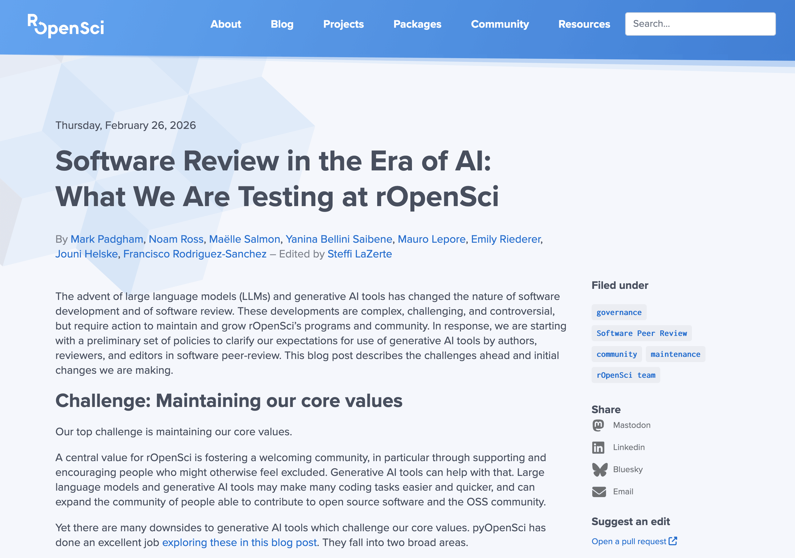{.r-stretch .shadow}

::: {.footer}
["Software Review in the Era of AI: What We Are Testing at rOpenSci"](https://ropensci.org/blog/2026/02/26/ropensci-ai-policy/)
:::

## {.quote-slide .clr-2}

> We do not want software review to become a service in which our human volunteers **validate largely AI-generated software**

—rOpenSci

::: {.footer}
["Software Review in the Era of AI: What We Are Testing at rOpenSci"](https://ropensci.org/blog/2026/02/26/ropensci-ai-policy/)
:::

##

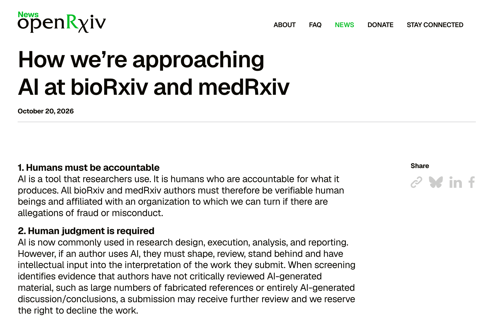{.r-stretch .shadow}

::: {.footer}
["How we’re approaching AI at bioRxiv and medRxiv"](https://openrxiv.org/approach-to-ai/)
:::

::: {.notes}
openRxiv: humans must be accountable, human judgment is required, humans make the final decision.
:::

##

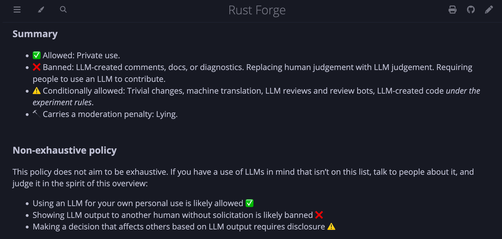{.r-stretch .shadow}

::: {.footer}
[Rust Forge LLM usage policy](https://forge.rust-lang.org/policies/llm-usage.html)
:::

::: {.notes}
Rust Forge bans LLM-authored comments in issues and PRs and prohibits LLM-only code review.

Slower, but this friction creates, cultivates, and maintains community trust.
:::

## {background-gradient="linear-gradient(30deg, , )"}

# Friction and forklifts {.section-slide background-gradient="linear-gradient(30deg, , )" background-image="img/background-hex-shapes.svg" background-opacity="0.25"}

## {background-gradient="linear-gradient(30deg, , )"}

::: {.notes}
Incidental friction can be automated away. Formative friction is still central… but AI is really good at removing that too.

So how do we know which kinds of friction to keep and when?
:::

## {.quote-slide .medium .clr-7}

> Using ChatGPT to complete assignments is like **bringing a forklift into the weight room**

—Ted Chiang (2024)

## {background-image="img/jhonatan-londono-_FF8CJbcios-unsplash-cropped.jpg" background-size="contain" background-color=""}

::: {.notes}
I agree with him… but I don't think we should stop Chiang's analogy here.
:::

## {background-image="img/kseniia-ilinykh-82ZiY5pzl1c-unsplash-cropped.jpg" background-size="contain" background-color=""}

::: {.notes}
Outside of weight rooms, forklifts have enormous value…
:::

##

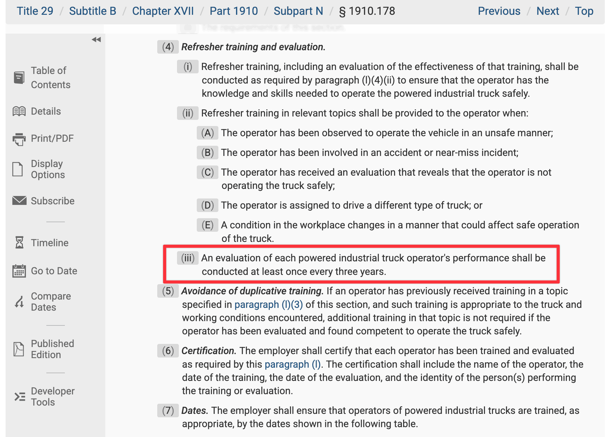{.r-stretch .shadow}

::: {.footer}
OSHA standard 29 CFR § 1910.178
:::

::: {.notes}
29 CFR §1910.178: recertify every three years.
:::

## {.clr-7}

::::: {.columns .box-center}
:::: {.column width="33%"}
::: {.fragment}
{.shadow .crop-4x3}

**[Gym]{.text-clr-7}**

::: {.small}
- Is the friction how I learn and improve?
- Are the side effects useful and important?
- Is the output directly human-facing?
:::
:::
::::

:::: {.column width="33%"}
::: {.fragment}
{.shadow .crop-4x3}

**[Warehouse]{.text-clr-7}**

::: {.small}
- Is this routine stuff I'm already good at?
- Is the task complex, but something I could theoretically do with time?
:::
:::
::::

:::: {.column width="33%"}
::: {.fragment}
{.shadow .crop-4x3}

**[Recertification]{.text-clr-7}**

::: {.small}
- Is this something I used to be good at?
- Could the friction end up being useful?
- Do I have time to slow down?
:::
:::
::::
:::::

# Friction worth keeping {.section-slide background-gradient="linear-gradient(30deg, , )" background-image="img/background-hex-shapes.svg" background-opacity="0.25"}

## {background-gradient="linear-gradient(30deg, , )"}

::: {.notes}
Remember that paper… skipped the squiggle.

LLMs can't tell the difference between the two types of friction. We have to do that.
:::

## {.center}

{width="1400" fig-align="center"}

::: {.footer}
[The Design Squiggle](https://thedesignsquiggle.com/)
:::

::: {.notes}
Sometimes we need to slow down and sit in the squiggle…

*That's* the friction worth keeping, and *that's* what keeps us human.
:::

## {.section-slide background-gradient="linear-gradient(30deg, , )" background-image="img/background-hex-shapes.svg" background-opacity="0.25"}

[**andhs.co/r-ai-2026**]{.huge}

andrewheiss.com
